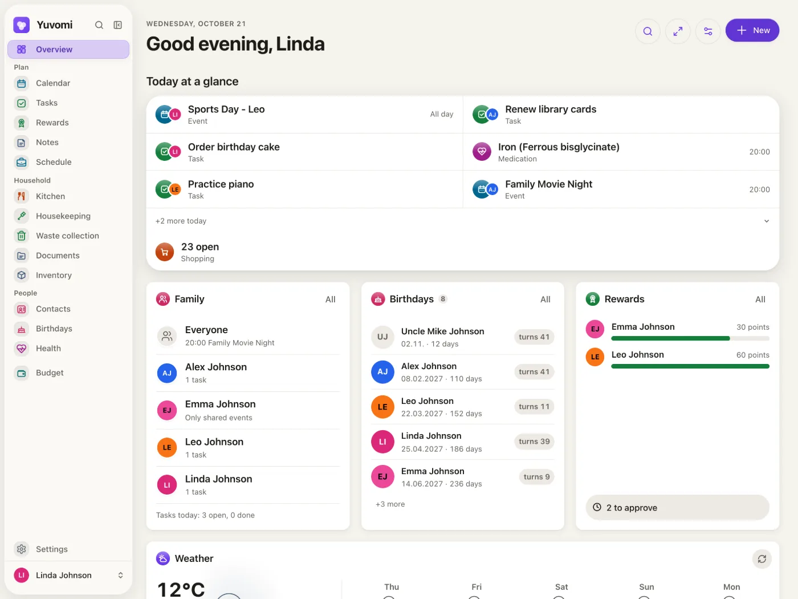
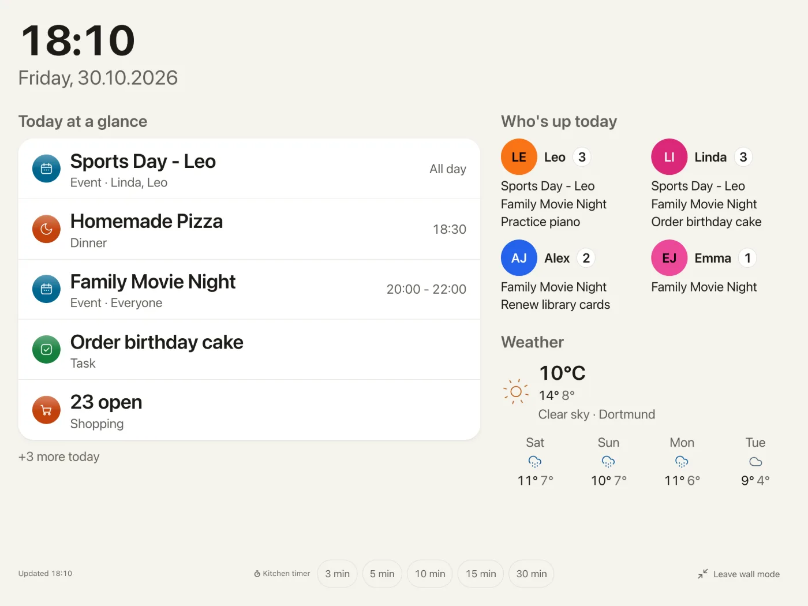
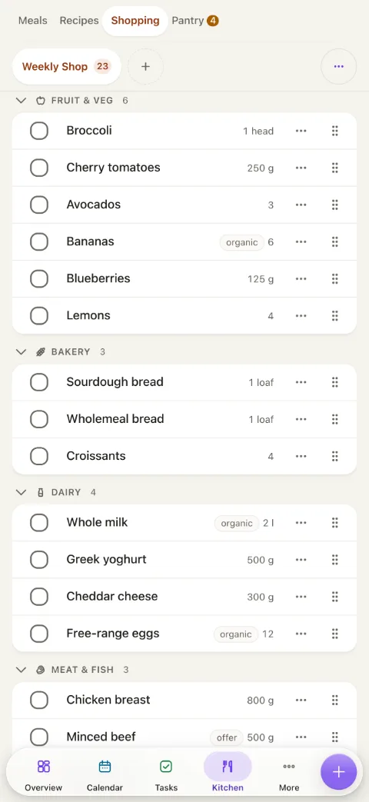

<div align="center">
  

  <h1>Yuvomi</h1>

  <p><strong>The self-hosted family planner.<br>One home instead of many subscriptions.</strong></p>

  <p>
    Tasks, calendar, budget, meals, health and more for a family, a couple or just you, on a
    server you own.
  </p>

  <p>
    <a href="https://github.com/ulsklyc/yuvomi/releases"></a>
    <a href="https://github.com/ulsklyc/yuvomi/stargazers"></a>
    <a href="https://github.com/ulsklyc/yuvomi/pkgs/container/yuvomi"></a>
    <a href="#install"></a>
    <a href="LICENSE"></a>
  </p>

  <p>
    <a href="https://yuvomi.cloud/"><strong>→ Take the tour on yuvomi.cloud</strong></a>&nbsp;&nbsp;·&nbsp;
    <a href="#install"><strong>Install</strong></a>&nbsp;&nbsp;·&nbsp;
    <a href="#documentation">Docs</a>&nbsp;&nbsp;·&nbsp;
    <a href="CHANGELOG.md">Changelog</a>&nbsp;&nbsp;·&nbsp;
    <a href="README.de.md" hreflang="de">Auf&nbsp;Deutsch</a>
  </p>

  <p><b>20</b>&nbsp;modules&nbsp;&nbsp;·&nbsp; <b>27</b>&nbsp;languages&nbsp;&nbsp;·&nbsp; <b>0</b>&nbsp;trackers&nbsp;&nbsp;·&nbsp; <b>1</b>&nbsp;SQLite&nbsp;file&nbsp;&nbsp;·&nbsp; <b>256&nbsp;MB</b>&nbsp;RAM&nbsp;minimum</p>

  <picture>
    <source media="(max-width: 600px) and (prefers-color-scheme: dark)" srcset="docs/screenshots/dashboard-dark-mobile.webp" width="200">
    <source media="(max-width: 600px)" srcset="docs/screenshots/dashboard-light-mobile.webp" width="200">
    <source media="(prefers-color-scheme: dark)" srcset="docs/screenshots/dashboard-dark-web.webp">
    
  </picture>
</div>

Most households glue their life together from a dozen paid apps, each with its own account, its
own subscription and its own copy of your data on someone else's server. Yuvomi puts all of it in
one place that belongs to you, running as a container on any home server or NAS.

---

## Many apps, one place

| Instead of juggling… | Yuvomi gives you |
|---|---|
| a to-do &amp; task app | **Tasks** - Kanban, deadlines, recurring, multi-assignment |
| a family calendar app | **Calendar** - sync, subscriptions, per-event visibility |
| a meal planner &amp; recipe app | **Meals &amp; Recipes** - weekly planner with shopping export |
| a grocery-list app | **Shopping** - shared, aisle-organized lists |
| a budgeting &amp; cost-splitting app | **Budget** - income, expenses, accounts, savings goals, shared costs with debt simplification |
| a document manager | **Documents** - searchable family files in folders |

## The modules talk to each other

This is the part a folder full of separate apps cannot do:

- **One import turns the week's meal plan into a shopping list.** The next seven days come pre-selected, and every ingredient lands on the shared list, sorted by aisle.
- **The last jar out of the pantry goes on the list with one tap.** After the shop, one button books what you ticked off back into the pantry, with amount and unit.
- **A ticked-off chore pays out.** Points on a task go to whoever did it - the assignee, or the person picked when it is ticked off - and are spent in a reward catalog you control.
- **A filed receipt hangs on the booking.** Upload it once and it belongs to the transaction, the shared expense and the inventory item at the same time.

## On the kitchen wall, in every pocket

<p align="center">
  <picture>
    <source media="(max-width: 600px) and (prefers-color-scheme: dark)" srcset="docs/screenshots/dashboard-wall-dark-web.webp" width="324">
    <source media="(max-width: 600px)" srcset="docs/screenshots/dashboard-wall-light-web.webp" width="324">
    <source media="(prefers-color-scheme: dark)" srcset="docs/screenshots/dashboard-wall-dark-web.webp">
    
  </picture>
  <picture>
    <source media="(max-width: 600px) and (prefers-color-scheme: dark)" srcset="docs/screenshots/shopping-dark-mobile.webp" width="170">
    <source media="(max-width: 600px)" srcset="docs/screenshots/shopping-light-mobile.webp" width="170">
    <source media="(prefers-color-scheme: dark)" srcset="docs/screenshots/shopping-dark-mobile.webp">
    
  </picture>
</p>

- **The tablet on the kitchen wall** shows today's plan and who is up in wall mode, readable across the room. It has an account of its own: tap a task, pick who did it, and the points go to them. When it sits idle, an Immich screensaver can show your own photos.
- **The app on every phone** goes on the home screen straight from the browser, no app store. Reminders arrive as push notifications even while it is closed (your server needs HTTPS for that), and the last shopping list you opened stays readable without signal.
- **Every member joins by invite link** and picks their own password; a child without a phone gets an account created directly. Per family role, each module is full, read only or not at all.

**Invited by your family?** Open the invite link your admin sent you; it works for seven days.
Choose a username if the invite leaves it open, and your own password (none if your household
signs in with single sign-on). Then sign in and put Yuvomi on your home screen: tap Install when
the app offers it, or on iPhone and iPad choose Share, then Add to Home Screen.

[More on yuvomi.cloud](https://yuvomi.cloud/#family)

## The twenty modules

Switch off what your household doesn't need, and it disappears from everyone's menu. Inventory,
Waste collection and Schedule start switched off.

<details>
<summary>
All 20 modules, one line each<br>
<b>Plan</b> - Tasks · Calendar · Rewards · Notes &amp; Contacts · Schedule<br>
<b>Household</b> - Kitchen (Meals · Recipes · Shopping · Pantry) · Housekeeping · Waste collection · Documents · Inventory<br>
<b>People</b> - Health · Birthdays<br>
<b>Finance</b> - Budget<br>
<b>Settings</b> - Family · Reminders · API Tokens · Backup
</summary>

| Module | In one line |
|---|---|
| **Tasks** | Kanban board with deadlines, subtasks, recurring chores, comments and a history of who ticked off what. |
| **Calendar** | Two-way Google and CalDAV sync, Outlook push, subscriptions, holidays and per-event visibility. |
| **Rewards** | Points from tasks, a parent-approved catalog, an auditable ledger and pocket money per child. |
| **Notes &amp; Contacts** | Markdown sticky notes with tappable checklists, plus contacts with CardDAV sync and vCard import/export. |
| **Schedule** | Rotating shifts and fixed weekly timetables, shown as an overlay in the calendar. Off by default. |
| **Meals** | Weekly drag-and-drop planner with a recipe sidebar and direct export to the shopping list. |
| **Recipes** | Create and scale recipes, fill meal slots, or mirror a Mealie or Tandoor instance read-only. |
| **Shopping** | Shared lists sorted by aisle, with swipe gestures and an import from the meal plan. |
| **Pantry** | Amounts, storage locations and best-before dates, with a reminder before something expires. |
| **Housekeeping** | Household staff: schedules, check-in/out, billing, chores and supply requests. |
| **Waste collection** | Pickup schedules per waste type, even "the last Friday", or a subscribed municipal ICS calendar. Off by default. |
| **Documents** | Searchable family files in folders, stored locally, on WebDAV or in Google Drive. |
| **Inventory** | What you own, with purchase price, warranty, linked receipts, a service log and recurring deadline reminders. Off by default. |
| **Health** | Per-member vitals, medications, preventive care, labs, activity, cycle tracking, a fasting journal and a nutrition log, with trend charts. |
| **Birthdays** | Birthdays and optional name days, with calendar entries, ages and reminders. |
| **Budget** | Income, expenses, accounts, loans, subscriptions and shared expenses with debt simplification. |
| **Family** | Member profiles with roles, and invite links where new members pick their own password. |
| **Reminders** | For tasks, events, medications, warranties, best-before dates, expiring documents and pickups - in-app, push, Gotify, ntfy, webhook or email. |
| **API Tokens** | Bearer tokens with an OpenAPI 3.1 spec and a built-in MCP endpoint for AI agents. |
| **Backup** | Manual and scheduled backups with optional WebDAV upload and pre-restore rollback; a backup from another installation restores right in the browser. |

</details>

Every module in full detail is in the [spec](docs/SPEC.md); building your own drop-in module - with
its own dashboard widgets, permissions and translations - is covered in the [module guide](MODULES.md).

---

## Before you commit

**What if this project stops?** Nothing changes on your machine. It is MIT-licensed and
self-hosted, and there is no server of ours anywhere in the path. The container you already pulled
keeps running exactly as it does today, with or without us.

**What if you want your data somewhere else?** Everything lives in one SQLite file on your own
disk, and copying it is the whole export, as long as documents are stored in the database.
Scheduled backups write a restorable archive on top of that, and the documented API pulls anything
out in whatever shape you need.

**How safe is access from outside?** Every account can add a second factor (TOTP, with recovery
codes), and an admin can require it for the whole household; new members join through an invite
link and pick their own password. With single sign-on through an OIDC provider, password login can
be switched off for the household, and a lost phone is signed out from any of your other devices.

**What does it cost?** Nothing. Yuvomi is free and MIT-licensed. You provide the server; there is
no subscription, no upsell and no paid tier.

**Does it phone home?** On its own, it only asks GitHub whether a newer version exists, and
blocking that breaks nothing. Anything else waits until you use or switch on a feature that needs
it; every connection is listed in the [Install](#install) section, under *Requirements, network
and your data*.

---

## Install

**From your NAS app store** - [TrueNAS SCALE](https://yuvomi.cloud/install.html#truenas),
[Umbrel](https://yuvomi.cloud/install.html#umbrel) or [Unraid](https://yuvomi.cloud/install.html#unraid):
search for Yuvomi in the catalog and install, no terminal.

**With Docker** on any server. The image `ghcr.io/ulsklyc/yuvomi:latest` is about 500 MB and runs
on amd64 and arm64 (Raspberry Pi 4/5); Yuvomi needs one port, 3000 by default.

```bash
curl -O https://raw.githubusercontent.com/ulsklyc/yuvomi/main/docker-compose.yml
curl -O https://raw.githubusercontent.com/ulsklyc/yuvomi/main/.env.example
cp .env.example .env
openssl rand -hex 32   # SESSION_SECRET
openssl rand -hex 32   # DB_ENCRYPTION_KEY
```

> **Now open `.env` and replace both `REPLACE_WITH_…` placeholders** with the two values, in that
> order, and write the second one down: it is the database key, and a lost or changed key never
> opens the database again, not by you and not by us. With a placeholder left in, Yuvomi refuses
> to start. To run without encryption, clear the `DB_ENCRYPTION_KEY` line instead of filling it.

```bash
docker compose up -d
```

Open `http://localhost:3000` and create your admin account. Podman, Proxmox, HTTPS, backups and
troubleshooting, step by step: the [install guide on yuvomi.cloud](https://yuvomi.cloud/install.html)
and the [installation guide](docs/installation.md).

<details>
<summary><b>Podman, Proxmox, the guided setup and the encryption key</b></summary>

- **Podman** - fetch `podman-compose.yml` instead of `docker-compose.yml` and start it with
  `podman compose -f podman-compose.yml up -d`; it carries the SELinux `:Z` volume labels that
  RHEL, Fedora and CentOS Stream need.
- **Page does not load** - `docker compose logs` (on Podman,
  `podman compose -f podman-compose.yml logs`) usually names the reason, and the
  [troubleshooting guide](docs/installation.md#troubleshooting) covers the common ones.
- **Proxmox** - the same steps run inside a small Debian LXC: see the
  [Proxmox guide on yuvomi.cloud](https://yuvomi.cloud/install.html#proxmox).
- **Encryption key** - optional, but there is no way back. The guided setup and Umbrel generate
  one for you; with Compose, TrueNAS or Unraid you set it yourself, so write it down.
- **Guided setup** - a localized setup wizard in your browser. It detects Docker or Podman, sets
  up single sign-on and scheduled backups, prepares Yuvomi for an HTTPS reverse proxy (the
  certificate stays with your proxy), then starts the container and creates your admin account.

  ```bash
  git clone https://github.com/ulsklyc/yuvomi.git && cd yuvomi
  node tools/installer/install-server.js
  ```

  Open **http://localhost:8090** on the server itself; the wizard answers nowhere else. From
  another device, open a tunnel first, `ssh -L 8090:localhost:8090 user@server`, then open the
  same address there. Needs Node.js 22.14+ or 23.6+ on the host; the container ships its own
  Node 24.

</details>

<details>
<summary><b>Requirements, network and your data</b></summary>

- **Browsers** - everything as designed from Chrome and Edge 117, Firefox 129 and Safari 17.5. Down to Chrome 87, Firefox 79 and Safari 14.1 (iOS 14.5) it still starts and scrolls, with a plainer look and some features missing ([measured 21 September 2026](docs/installation.md#browser-support)).
- **Writes** - four volumes you own: data, backups, modules, documents.
- **Outbound** - on its own, one update check against the GitHub releases API. Block it and nothing breaks, only the hint about a newer version stays away. Everything else reaches out only when you use or switch on a feature that needs it:
  - **When you use it** - opening the calendar settings loads the list of holiday countries from openholidaysapi.org; finding a logo for a subscription looks up the service's website.
  - **If the operator turns it on** - fetching your profile picture from Gravatar sends a hash of your email address to gravatar.com or the mirror the operator chose; with web install allowed, an admin can install extension modules from GitHub.
  - **Once you switch them on** - weather, public holidays, exchange rates, calendar and contact sync, recipe mirrors, Immich, Paperless or Papra, push and notification channels, cloud storage and backup.
- **Your LAN** - calendar subscriptions, notification channels (webhook, Gotify, ntfy), WebDAV document storage, recipe mirrors and waste-collection feeds on private or internal addresses stay blocked until you opt in ([how](docs/installation.md#environment-variables)). Paperless and Papra are the exception: they may reach the LAN out of the box.
- **Your data** - one SQLite file at `/data/yuvomi.db`, plus the folder, WebDAV or Drive if you moved documents there.

</details>

<details>
<summary><b>Before you go live: health data, Google Drive sharing and GDPR</b></summary>

<br>

> **Health is not a medical device.** No diagnostic claims are made. Health data is sensitive, so enable database encryption (`DB_ENCRYPTION_KEY`, SQLCipher).

> **External document storage needs its own backup.** Database backups hold document metadata and links, not binaries stored in a local folder, on WebDAV, or in Google Drive; back up the selected target separately. Yuvomi visibility settings only control access through Yuvomi. Anyone with access to the connected `Yuvomi/Documents` Google Drive folder can view all files stored there.

> **Self-hosting in a GDPR context?** If you run Yuvomi in the EU/EEA and process other people's data, read [privacy for self-hosters](docs/PRIVACY-FOR-SELFHOSTERS.md) before going live. It covers third-country assessments for every external service, data-processing-agreement notes, log-retention guidance and a records-of-processing template.

</details>

<details>
<summary>Coming from <b>Oikos</b>, or seeing <code>oikos</code> in an app store? Same app, renamed.</summary>

<br>

Yuvomi was renamed from **Oikos** to avoid a trademark conflict with an unrelated product. Same code, same data, same maintainer.

- Old links (`github.com/ulsklyc/oikos`) redirect here automatically.
- The Docker image moved to `ghcr.io/ulsklyc/yuvomi`; the old `ghcr.io/ulsklyc/oikos` keeps working, so update at your convenience.
- Existing data and settings are fully preserved on upgrade.
- Some catalog slugs keep the technical name `oikos` (e.g. Unraid `oikos-…`) so existing installations upgrade seamlessly. Search for **Yuvomi**; an entry still shown as *oikos* is the same app.

</details>

---

## Under the hood

- **No build step** - pure ES modules and plain CSS. No bundler, no transpiler, no framework, no runtime CDN.
- **Feels like a native app** - built to Apple's interface guidelines: the system font, capsule buttons, grouped lists and spring motion, with WCAG AA contrast checked in light and dark.
- **Privacy first** - fully self-hosted, optional SQLCipher AES-256 database encryption, zero telemetry.
- **Sign-in for a whole household** - two-factor authentication, invite links, optional password reset by email and single sign-on with any OIDC provider; see [how safe access from outside is](#before-you-commit).
- **Your language, detected automatically.** A separate household setting decides the language of entries Yuvomi creates itself, so an exported calendar speaks your household's language instead of English.
- **Stack** - Node.js and Express with SQLite (SQLCipher), one container for Docker or Podman, a PWA on every phone.

---

## Documentation

- **See it** - [Tour and screenshots on yuvomi.cloud](https://yuvomi.cloud/)&nbsp;&nbsp;·&nbsp; [Install guide on yuvomi.cloud](https://yuvomi.cloud/install.html)
- **Run it** - [Installation](docs/installation.md)&nbsp;&nbsp;·&nbsp; [Security](SECURITY.md)&nbsp;&nbsp;·&nbsp; [Privacy for self-hosters](docs/PRIVACY-FOR-SELFHOSTERS.md)&nbsp;&nbsp;·&nbsp; [Notification webhooks](docs/notification-webhooks.md)&nbsp;&nbsp;·&nbsp; [Immich screensaver](docs/immich-screensaver.md)
- **Build on it** - [Spec &amp; data model](docs/SPEC.md)&nbsp;&nbsp;·&nbsp; [Third-party modules](MODULES.md)&nbsp;&nbsp;·&nbsp; [Contributing](CONTRIBUTING.md)
- **Follow the project** - [Changelog](CHANGELOG.md)&nbsp;&nbsp;·&nbsp; [Roadmap](docs/ROADMAP.md)&nbsp;&nbsp;·&nbsp; [Decisions](docs/DECISIONS.md)&nbsp;&nbsp;·&nbsp; [Scope](docs/SCOPE.md)&nbsp;&nbsp;·&nbsp; [Backlog](BACKLOG.md)&nbsp;&nbsp;·&nbsp; [Releasing](docs/RELEASING.md)

**User guide (community-maintained):** @Kyrodan writes a [user documentation site](https://kyrodan.github.io/yuvomi-docs/)
in his own repository. It is not part of this project and can lag behind a release, so where it and
the sources above disagree, the ones above are right.

---

<div align="center">
  <br>
  
  <p><strong>One home for your household. Yours to keep.</strong></p>
  <p>
    Install it once. No account with us, no subscription,<br>
    and nothing of ours between your household and its data.
  </p>
  <p>
    <a href="#install"><strong>→ Install it</strong></a>&nbsp;&nbsp;·&nbsp;
    <a href="https://yuvomi.cloud/"><strong>Take the tour</strong></a>&nbsp;&nbsp;·&nbsp;
    <a href="https://github.com/ulsklyc/yuvomi/discussions"><strong>Ask a question</strong></a>
  </p>
  <br>
  <sub>MIT licensed, see <a href="LICENSE">LICENSE</a>. More at <a href="https://yuvomi.cloud/">yuvomi.cloud</a>.</sub>
</div>
